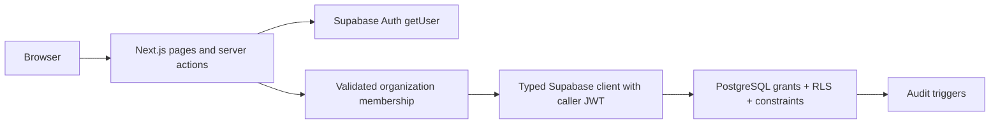

# Architecture

## Implemented boundary

One Next.js App Router application serves the public brand homepage and private CRM. React Server Components load data; client components provide accessible forms using server actions. Zod validates every mutation. The domain layer is independent of pages. Source-owned shadcn/ui primitives use Tailwind, Radix Slot, and class-variance-authority. No Framer, Sites hosting runtime, or paid service dependency is required.

Request flow:

The proxy refreshes Supabase cookies; layouts and every action authenticate independently. `requireContext` validates the preferred organization cookie against the user's actual memberships. User credentials never grant authority by client-supplied organization IDs. All application database access uses a publishable/anon key plus the user session. The service role is not used.

`create_organization` is a tightly scoped security-definer transaction inserting only a new organization and its current caller's owner membership. Read permission helpers use a fixed empty search path and the current auth identity. `create_prospect` and `crm_summary` are security-invoker functions and retain RLS. Database triggers create audit events without exposing a client-writeable log.

## Local and hosted runtimes

The default lightweight development profile uses real PostgreSQL 15, Supabase Auth, PostgREST and a local-only routing gateway. It runs the same application migration as a hosted Supabase project. It has no Storage/Realtime/Studio and must not be used as production self-hosting. Its DB/auth bootstrap helpers live separately from the production migration. Standard Supabase CLI configuration is also included. Hosted production targets managed Supabase and Vercel-compatible Node hosting; no application code depends on Docker.

The PWA manifest supports installation. The service worker provides a static offline message on network failure; it never writes CRM data or authenticated responses to caches. The application remains online-only.

## Future module contracts (not implemented)

- Discovery: provider interface `discover(query, cursor, budget)` returns normalized businesses plus evidence/provenance; provider capabilities declare permitted fields, licensing, attribution and rate limits. No protected-platform scraping.
- Qualification: versioned scoring policy with five criteria, evidence links, observed-at times, verified/assumed distinction and confidence. Store inputs and explanations, never a bare unexplained score.
- Growth reviews: versioned observations/recommendations under Digital Presence, Social Presence and Customer Growth; editable artifacts, human approval, then branded PDF generation and separately authorized delivery.
- AI: server-only provider interface for structured generation, model configuration, token/cost accounting and budgets. OpenAI and Ollama adapters behind one boundary. No API calls in Phase 1.
- Automation: Inngest (or a reliable equivalent) event handlers persist job state, idempotency keys, retries, quotas and cancellation. Pause/stop controls must be enforced by workers before every side effect, not only by UI.
- Google: encrypted refresh-token storage, least-privilege grants, explicit draft version approvals, bounded Gmail sends, thread sync, opt-outs and Calendar. See GOOGLE_INTEGRATION.md.
- Commerce: proposals, separately signed contracts, schedules and Stripe test-mode checkout/invoices. Verified webhook events are authoritative for payment; a redirect is not. Annual contract obligations and recurring charges are distinct.
- Delivery: client workspaces, scoped tasks, private Storage assets, deliverables/revisions, cost ledger and monthly reporting. Creator fulfillment remains a future extension point.

## Design rules

Keep tenant keys on every future tenant-owned table; enforce composite tenant foreign keys. External provider calls must be server-side and use explicit allowed capabilities, timeouts and spend limits. Audit evidence is immutable/versioned and outbound artifacts require human approval. Do not merge future workflows into Phase 1 forms as nonfunctional controls.

## Prospect import and manual research extension

See PROSPECT_BATCH_001.md. The existing architecture now includes server-side csv-parse + Zod preview/mapping, persisted owner-scoped import batches/rows, transactional idempotent import RPCs with commit-time identity checks, A/B/C research priorities, three-point review records with optimistic revision checks, owner approval and a database-level pipeline gate, plus draft-only outreach preparation. All new tables enforce tenant RLS and deny direct writes; narrowly scoped RPCs recheck membership/owner role before mutations. This is manual research and neutral template generation, not AI validation, qualification scoring, PDF delivery or sending.

## Preparation and personal app extension

See AGENT_CONTROL.md for the PostgreSQL durable preparation queue, owner-authenticated execution, evidence-based proposals, owner acceptance, append-only contact events and persistent suppression. The baseline generator is deterministic rules, not an LLM. Optional Explee company search is server-only and budgeted; it does not send or enrich contacts.

The Electron personal shell bundles the same Next standalone output, starts it on a random loopback port, and keeps renderer Node integration off, context isolation and sandboxing on. It can instead open the hosted HTTPS app. Phone installation uses the existing PWA; private responses remain online-only. Runtime server Supabase aliases support backend selection without embedding user credentials. No framework or database was reinitialized.
