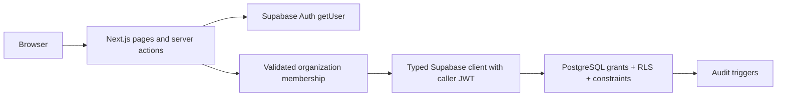

# Architecture

## Implemented boundary

One Next.js App Router application serves the public brand homepage and private CRM. React Server Components load data; client components provide accessible forms using server actions. Zod validates every mutation. The domain layer is independent of pages. Source-owned shadcn/ui primitives use Tailwind, Radix Slot, and class-variance-authority. No Framer, Sites hosting runtime, or paid service dependency is required.

Request flow:

The proxy refreshes Supabase cookies; layouts and every action authenticate independently. `requireContext` validates the preferred organization cookie against the user's actual memberships. User credentials never grant authority by client-supplied organization IDs. All application database access uses a publishable/anon key plus the user session. The service role is not used.

`create_organization` is a tightly scoped security-definer transaction inserting only a new organization and its current caller's owner membership. Read permission helpers use a fixed empty search path and the current auth identity. `create_prospect` and `crm_summary` are security-invoker functions and retain RLS. Database triggers create audit events without exposing a client-writeable log.

## Local and hosted runtimes

The default lightweight development profile uses real PostgreSQL 15, Supabase Auth, PostgREST and a local-only routing gateway. It runs the same application migration as a hosted Supabase project. It has no Storage/Realtime/Studio and must not be used as production self-hosting. Its DB/auth bootstrap helpers live separately from the production migration. Standard Supabase CLI configuration is also included. Hosted production targets managed Supabase and Vercel-compatible Node hosting; no application code depends on Docker.

The PWA manifest supports installation. The service worker provides a static offline message on network failure; it never writes CRM data or authenticated responses to caches. The application remains online-only.

## Remaining module contracts

- Discovery: provider interface `discover(query, cursor, budget)` returns normalized businesses plus evidence/provenance; provider capabilities declare permitted fields, licensing, attribution and rate limits. No protected-platform scraping.
- Qualification: versioned scoring policy with five criteria, evidence links, observed-at times, verified/assumed distinction and confidence. Store inputs and explanations, never a bare unexplained score.
- Growth reviews: versioned observations/recommendations under Digital Presence, Social Presence and Customer Growth; editable artifacts, human approval, then branded PDF generation and separately authorized delivery.
- AI: implemented structured recommendation adapters (rules/Ollama/OpenAI), with fixed observations, manual verification and bounded configured costs. Rich audit/PDF artifacts remain future work.
- Automation: Inngest (or a reliable equivalent) event handlers persist job state, idempotency keys, retries, quotas and cancellation. Pause/stop controls must be enforced by workers before every side effect, not only by UI.
- Google: OAuth, manually approved sends, optional policy-controlled tracked replies/opt-outs and offered-time scheduling are described in GOOGLE_INTEGRATION.md and ACQUISITION_ENGINE.md.
- Commerce: proposals, separately signed contracts, schedules and Stripe test-mode checkout/invoices. Verified webhook events are authoritative for payment; a redirect is not. Annual contract obligations and recurring charges are distinct.
- Delivery: client workspaces, scoped tasks, private Storage assets, deliverables/revisions, cost ledger and monthly reporting. Creator fulfillment remains a future extension point.

## Design rules

Keep tenant keys on every future tenant-owned table; enforce composite tenant foreign keys. External provider calls must be server-side and use explicit allowed capabilities, timeouts and spend limits. Audit evidence is immutable/versioned and outbound artifacts require human approval. Do not merge future workflows into Phase 1 forms as nonfunctional controls.

## Prospect import and manual research extension

See PROSPECT_BATCH_001.md. The existing architecture now includes server-side csv-parse + Zod preview/mapping, persisted owner-scoped import batches/rows, transactional idempotent import RPCs with commit-time identity checks, A/B/C research priorities, three-point review records with optimistic revision checks, owner approval and a database-level pipeline gate, plus draft-only outreach preparation. All new tables enforce tenant RLS and deny direct writes; narrowly scoped RPCs recheck membership/owner role before mutations. This is manual research and neutral template generation, not AI validation, qualification scoring, PDF delivery or sending.

## Preparation and personal app extension

See AGENT_CONTROL.md for the PostgreSQL durable preparation queue, owner-authenticated execution, evidence-based proposals, owner acceptance, append-only contact events and persistent suppression. The baseline generator is deterministic rules, not an LLM. Optional Explee company search is server-only and budgeted; it does not send or enrich contacts.

The Electron personal shell bundles the same Next standalone output, starts it on a random loopback port, and keeps renderer Node integration off, context isolation and sandboxing on. It can instead open the hosted HTTPS app. Phone installation uses the existing PWA; private responses remain online-only. Runtime server Supabase aliases support backend selection without embedding user credentials. No framework or database was reinitialized.

## Shared conversion and discovery adapters (0.2.2)

`src/lib/converter` contains bounded spreadsheet parsing, template mappings, row validation and CSV/XLSX/JSON export. ExcelJS loads on demand in the client. No employee/payroll data leaves the browser. Prospect conversion hands canonical text to the existing authenticated import preview and commit actions. `openstreetmap.ts` is a fixed-endpoint, bounded key-free provider; optional Explee remains isolated. Neither adapter changes the CRM until an owner reviews and commits an import. See DATA_CONVERTER.md and COMPANY_WORKSPACES.md for current boundaries and proposed company-specific templates.

## Controlled acquisition and appointments (0.3.0)

Opt-in discovery uses database-clock hourly keys, fixed categories, per-day limits and owner-session execution. The web runner operates while open; the desktop runner uses a native timer and the same authenticated, origin-checked endpoint. Neither runs while the app/PC is off. Successful discovery stages a normal import preview, never an unapproved business import. Historical source IDs filter repeat candidates.

Google refresh credentials are AES-GCM encrypted with organization, owner and runtime key identity as associated data. Ciphertext lives in an unexposed private schema behind owner-only functions. Desktop secrets additionally use OS-backed safeStorage. OAuth uses state and PKCE, verifies the fixed sender account and requests send/owned-calendar capabilities without Gmail reading. Delivery approval binds the exact recipient, draft revision and complete message with sender identity/footer; a single claim precedes the provider call. Uncertain outcomes cannot be automatically retried, and the manual resolution interface remains future work. These adapters have synthetic provider tests; real Google account setup and live validation remain pending.

Agreed appointments require a recorded agreement, enforce Eastern weekday working hours, and prevent local overlaps. Calendar writes require separate approval, deterministic event IDs and an availability check. Guest invitations require explicit approval; internal agreement notes never enter event descriptions. Dashboard opportunity estimates count each open lead once with an active agreed appointment and refresh through an authenticated, uncached endpoint every ten visible seconds. Estimates are not revenue or signed contracts.

## Vertical pipeline and recoverable removal

Pipeline stages are stacked, collapsible and paged in the client (12 cards per stage page), with a sticky search/jump toolbar. Only display fields cross the pipeline's client boundary. The existing 500-recent-lead ceiling remains explicit; the table searches the full organization.

`leads.deleted_at` / `deleted_by` implement recoverable removal. Active lead SELECT/UPDATE policies exclude removed rows, so invoker summaries and active lead joins stay consistent. Owner-checked private functions expose paged Trash and state transitions through invoker RPC wrappers. New columns have no direct update grant. Removal shares the existing agent/calendar advisory locks, refuses in-flight/uncertain external operations and upcoming appointments, cancels pending preparation/unsent approvals, and retains append-only history. `private.agent_blocked` excludes removed/missing leads even inside privileged worker APIs. Business identity uniqueness and suppression persist across removal/restoration; restore does not restart cancelled work.

## Regional acquisition engine

See [ACQUISITION_ENGINE.md](ACQUISITION_ENGINE.md), which supersedes the older draft-only/unsupported-replies descriptions above for the optional engine. The existing stack is preserved. Pipeline queries use caller-scoped PostgreSQL server pagination; inventory aggregates are full-tenant counts. Engine settings, coverage, cursors, replies, slot offers and outbox records have RLS and composite tenant keys. Owner-only invoker entrypoints dispatch fixed-search-path private transactions; no anonymous worker or application service-role bypass exists.

The owner-session heartbeat runs bounded discovery/research plus at most one email action during Eastern working hours. Public-web research pins validated DNS addresses and honors robots restrictions; deterministic rules are free, Ollama is fixed-loopback, OpenAI requires explicit bounded configuration. Observations cannot be model-verified. A seven-day template/identity/quota policy and three manually verified review pillars gate automatic sending. Actual tracked replies and explicit offered-time selection gate appointments. Existing manually approved sends remain separate but share the global account ceiling. Unknown network outcomes never retry automatically. This is local app availability, not hosted durable scheduling.

## Guided operations

The iR Agent route presents a closed set of task choices over the existing server actions and permission gates; it is a deterministic workflow interface. The prior controls remain under `/dashboard/agents/advanced`. Shared campaign presentation avoids separate approval implementations. Additive schedule fields enforce bounded weekday windows and cadence at the database claim/tick boundaries. See GUIDED_ASSISTANT.md.
